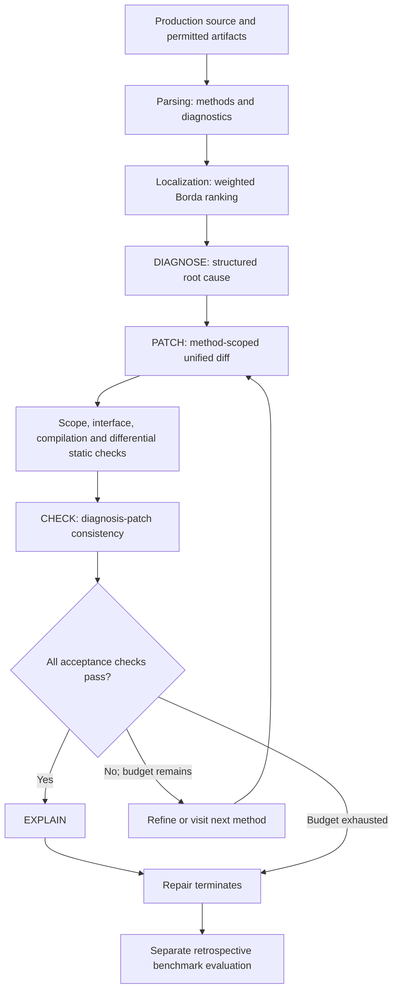

# Implementation architecture

`Parsing` extracts method identities, source ranges and diagnostic evidence.
`Ranking` combines artifact-specific ranks with normalized available weights.
`Reasoning` implements versioned prompts, schemas and bounded API attempts.
`Validation` applies a candidate in an isolated copy and combines deterministic
checks with CHECK. `Pipeline` preserves diagnosis across refinement, enforces
search budgets and invokes EXPLAIN only after acceptance.

The Core library is shared by the ASP.NET Core web application and CLI. The
experiment runner wraps the same pipeline, records reproducibility metadata and
runs retrospective oracles only after repair termination. Optional baseline
reproduction is an eligibility check; its output is not passed to inference.
Reference labels and reference patches are excluded from model context.

The default search visits up to five ranked methods, with one initial candidate
and at most three refinements per method, subject to the global 20-call and
16000-token budgets. Individual stage limits are documented in
[llm-output-controls.md](llm-output-controls.md).

Configured compilers and analyzers must actually execute. Missing tools are
reported as unavailable and cannot yield a framework-plausible patch. A patch
passing these checks is not proven functionally correct. Retrospective test
passing and independently verified correctness are separate recorded outcomes.

Configuration: [configuration.md](configuration.md).
Benchmark execution: [experiments.md](experiments.md).
